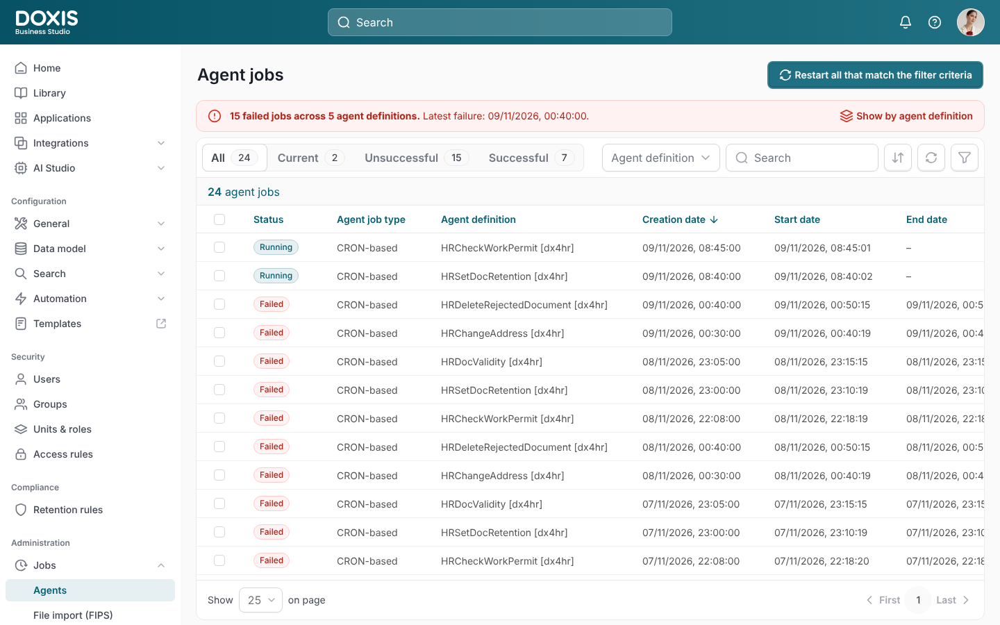
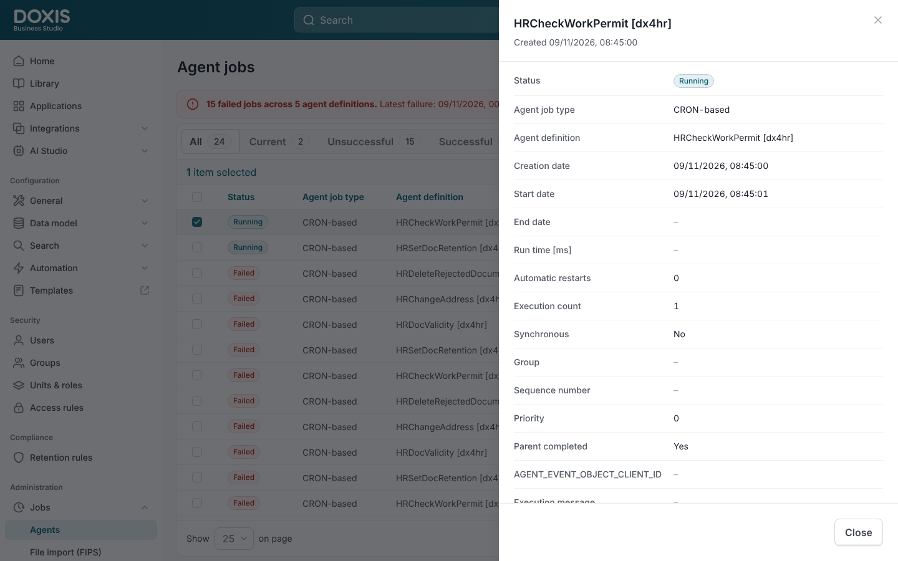
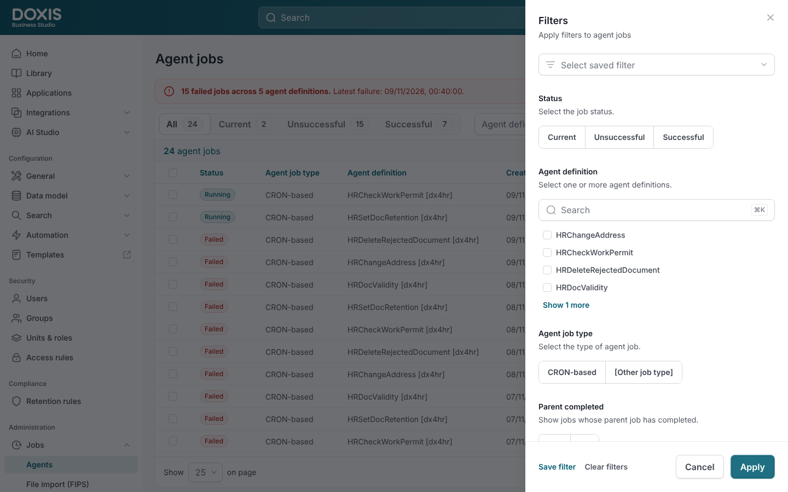
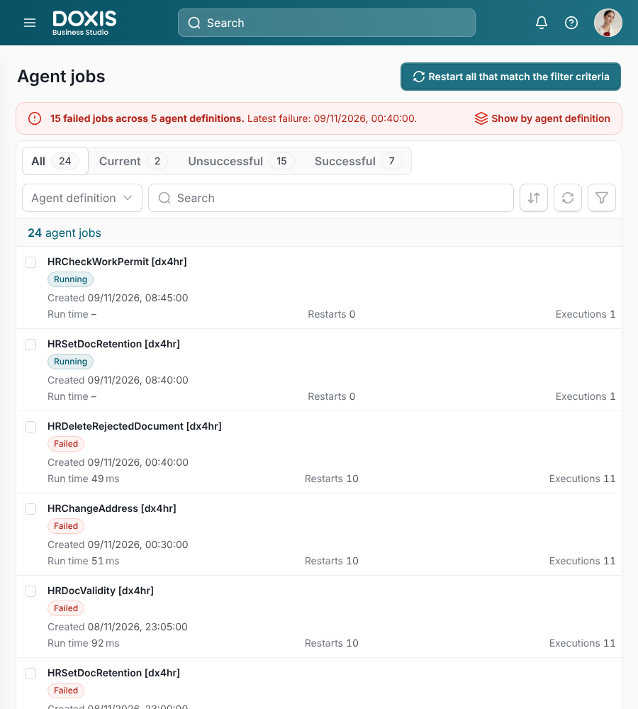
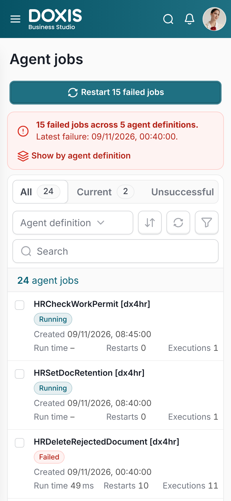

# Agent jobs – Doxis Business Studio prototype

Clickable, responsive prototype of the redesigned **Agent jobs** page (Administration › Jobs › Agents).
Plain HTML, CSS and JavaScript: no build step and no dependencies apart from Google Fonts.



| Details panel | Filters drawer |
| --- | --- |
|  |  |

| Tablet | Phone |
| --- | --- |
|  |  |

## Publish on GitHub Pages (live link)

1. Create a new repository on GitHub (for example `agent-jobs`). It can be public, or private if your plan includes Pages for private repos.
2. Upload the **contents** of this folder to the repository root (drag and drop on github.com › *Add file › Upload files*, or with git):
   ```bash
   cd agent-jobs
   git init -b main
   git add .
   git commit -m "Agent jobs prototype"
   git remote add origin https://github.com/<user-or-org>/agent-jobs.git
   git push -u origin main
   ```
   Make sure the hidden `.github` folder is included (the git commands above do this; drag and drop on macOS may skip hidden folders, so press ⌘⇧. in Finder to show them).
3. In the repository go to *Settings › Pages › Build and deployment* and set **Source** to **GitHub Actions**.
4. The included workflow (`.github/workflows/pages.yml`) deploys on every push to `main`. After about a minute the link appears under *Settings › Pages* and on the workflow run:
   `https://<user-or-org>.github.io/agent-jobs/`

Alternative without Actions: set **Source** to **Deploy from a branch**, choose `main` and `/ (root)`.

### Updating an existing repository

Replace all files in the repository with the contents of this folder and push (or upload) again; the workflow redeploys automatically.
`index.html` loads the CSS and JS with a version suffix (`?v=20261112`). Change it when you edit those files so browsers don't keep an old cached copy.

## Run it locally

Open `index.html` in a browser (double-click works), or serve the folder with `npx serve .` or `python3 -m http.server`.

## What works

- **Status tabs** (All, Current, Unsuccessful, Successful) with live counts
- **Failed jobs banner** on every tab while failed jobs exist, switching between the list and the view grouped by agent definition
- **Restart all that match the filter criteria** (disabled when no failed job matches)
- **Agent definition** multi-select dropdown with search, and text search
- **Sort** menu (Creation date or grouped by agent definition, descending or ascending, search restrictions), Refresh, and **Filters** drawer (Status, Agent definition, Agent job type, Parent completed, Source, Creation date, ID & text search) with Apply, Cancel and Clear
- **Table** with all 23 columns of the current Business Studio screen; it scrolls inside its card with always-visible scrollbars and a pinned header row
- **Row selection**: click a row (or its checkbox) to select it; the bar above the table shows the total number of jobs, or the selection with **Restart**, **Delete** and **Display details** (single selection)
- **Details side panel** (640px) with every field of the job and its status badge; opens with Display details or by double-clicking a row; Escape closes it
- **Notifications** in the top right corner, with Undo for restart and delete

Fields without sample data (Group, Sequence number, Trigger, Agent Runtime Service, Process class, Task and similar) show "–".

## Responsive behaviour

| Width | Layout |
| --- | --- |
| > 1100px | Full layout with fixed side menu, toolbar on one line |
| 901–1100px | Side menu becomes a slide-in menu (hamburger), toolbar wraps onto two lines |
| 721–900px | Table rows turn into cards (status, agent definition, creation date, run time, restarts, executions) |
| ≤ 720px | Header search moves behind an icon, drawers and the details panel are full screen, popovers open as bottom sheets |

## Files

```
index.html                    page shell
css/styles.css                design tokens, components, breakpoints
js/icons.js                   Untitled UI icon paths (from the Doxis Figma library)
js/data.js                    sample jobs, job IDs, table columns and side menu – replace with API data
js/app.js                     state, rendering and interactions
assets/                       Doxis logo and avatar
docs/                         screenshots used in this README
.github/workflows/pages.yml   GitHub Pages deployment
.nojekyll                     serve files as they are (no Jekyll processing)
```

## Notes

- Colors, type and spacing follow the Doxis One.Cloud design system and the Business Studio Figma files.
- Sample data uses the HR agent definitions from the current Business Studio screen; it contains no customer data.
- Firefox on macOS may still hide the table scrollbars while you're not scrolling, because it doesn't support custom scrollbar styling. Chrome, Edge and Safari keep them visible.
